# HarvestMoonSnesDecomp — descompilación de Harvest Moon (SNES)

[English](README.md) · **Español**

<!-- progress -->


**100.00%** del código del juego descompilado y verificado: 45176 de 45176 instrucciones, 778 de 778 rutinas (100.0%).
Se calcula con `python3 tools/progress.py --decomp ../HM-Decomp` sobre el desensamblado de HM-Decomp.
<!-- /progress -->


El juego reescrito, rutina por rutina, como C que una persona puede leer.
Cada rutina reescrita se **comprueba contra la original byte por byte**: la
memoria completa (128 KB de WRAM, pila incluida), los registros del CPU y
los registros de DMA tienen que quedar idénticos.

Es un proyecto hermano del port jugable
[HarvestMoonSNESRecomp](https://github.com/RodriLoy/HarvestMoonSNESRecomp)
y se apoya en el desensamblado de la comunidad
[HM-Decomp](https://github.com/ElisaS-Codes/HM-Decomp) (ElisaS-Codes y DasK),
de donde vienen los nombres de las rutinas y el mapa de memoria.

| | HarvestMoonSNESRecomp | HarvestMoonSnesDecomp (este) |
|---|---|---|
| Para qué | Jugar: el port de PC con sus mejoras | Entender el juego: código legible |
| Resultado | El juego (`.exe`) | Rutinas en `src/`, un ejecutable de prueba y el juego jugable compilado solo con ellas |
| Depende de | Tu ROM | Tu ROM (el comprobador, además, el proyecto de recompilación) |

## Jugarlo: la versión nativa

Con el 100 % reescrito, el juego **se juega solo con el C descompilado**:
sin código recompilado y sin emular la CPU. Cada rutina del juego es una
función de C de `src/`, llamada directamente. Lo único que sigue en
software son el chip de imagen y el de sonido de la consola (los gráficos y
la música del cartucho están en sus formatos), del runner de snesrecomp sin
cambios, incluidos en `native/chips/`. Además trae todas las mejoras de la
recompilación y un launcher nuevo.

> [!IMPORTANT]
> **Necesitas tu propia copia del juego, obtenida legalmente.** Este
> repositorio no contiene la ROM ni nada generado a partir de ella, ni
> ejecutables: el juego se compila en tu computadora. Por favor no pidas ROMs.

### Cómo jugarlo en Windows

1. Descarga este repositorio (*Code → Download ZIP*) y descomprímelo.
2. Doble clic en **`compilar_nativo.bat`**. La primera vez descarga un
   compilador de C (llvm-mingw) y SDL3 (unos 190 MB, revisados por su
   SHA-256); después compila en menos de un minuto y deja
   `HarvestMoonNative.exe` y `SDL3.dll` en la carpeta.
3. Ábrelo. La primera vez te pide **tu ROM** de *Harvest Moon (USA)*; la
   revisa y la recuerda.

Como lo compilas tú, Windows no lo trata como un programa descargado de
internet. En Linux: ver [Cómo funciona la versión nativa](#cómo-funciona-la-versión-nativa).

### Launcher con el aspecto del juego

Una granja de noche bajo la luna de la cosecha, marcos de madera, pergamino
y la mano que señala, todo dibujado a la resolución del SNES, así que sus
píxeles son del tamaño de los del juego. Se maneja con teclado, mando o
ratón, en **español, inglés o italiano**. En el juego se abre con **Esc**
(o L3 / Guía en el mando, o OPTIONS en el título) y el juego queda en pausa
mientras la música sigue.

| Launcher | Primera vez: elegir la ROM |
|---|---|
| 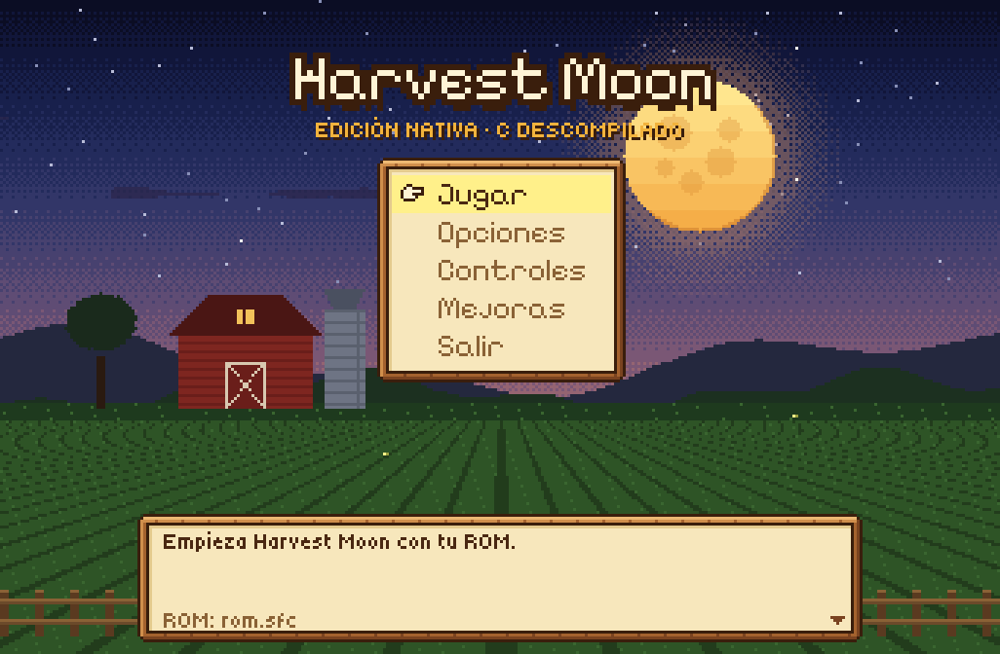 | 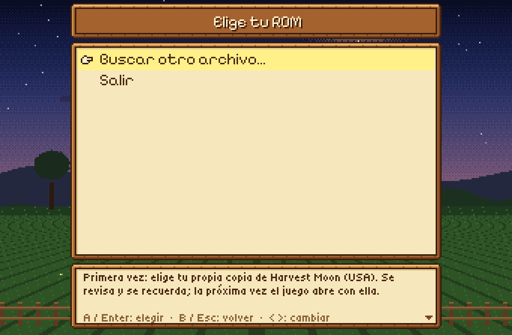 |

- **Opciones** — pantalla completa, tamaño de ventana (×1 a ×6), imagen
  nítida o de píxeles exactos, sincronía vertical, pantalla ancha, sprites
  sin parpadeo o como la consola, volumen, velocidad del avance rápido,
  idioma y si este menú aparece al iniciar.
- **Controles** — cada botón de la SNES en el teclado y en el mando
  (presionas la tecla o el botón nuevo); los mandos conectados (Xbox,
  PlayStation, Switch Pro… por USB o Bluetooth) aparecen al momento y eliges
  cuál juega; el botón que presionas se ilumina para probarlo.
- **Estados guardados** — 10 ranuras (también F1–F10 cargar,
  Shift+F1–F10 guardar). No tocan tus diarios.
- Todo se guarda en `config.ini` y `keybinds.ini` (el mismo formato de la
  recompilación, así que tus teclas sirven en los dos).

| Opciones | Controles | Mando |
|---|---|---|
| 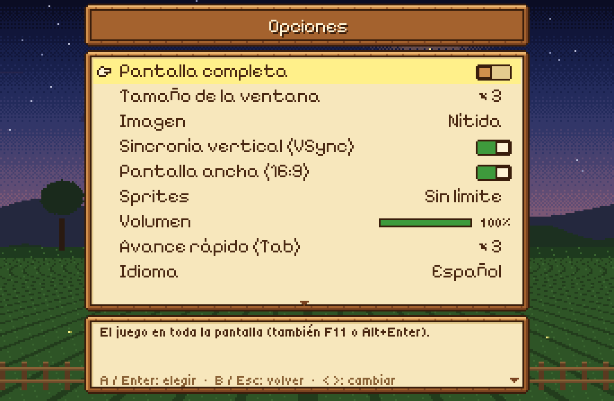 | 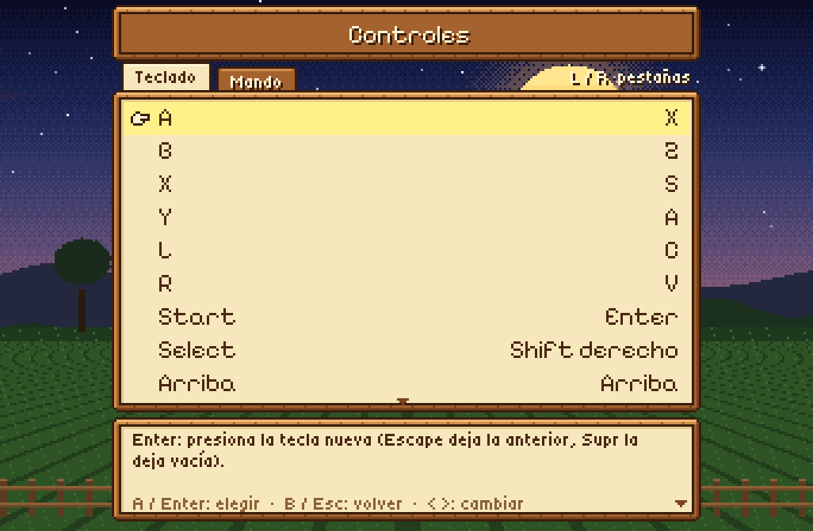 | 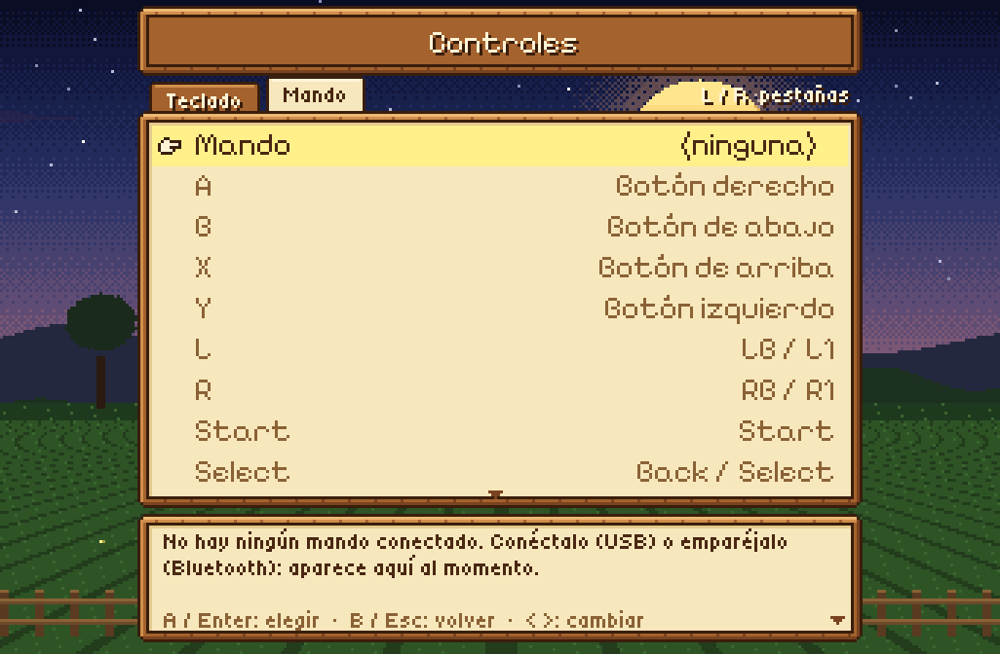 |

| En el juego |
|---|
| 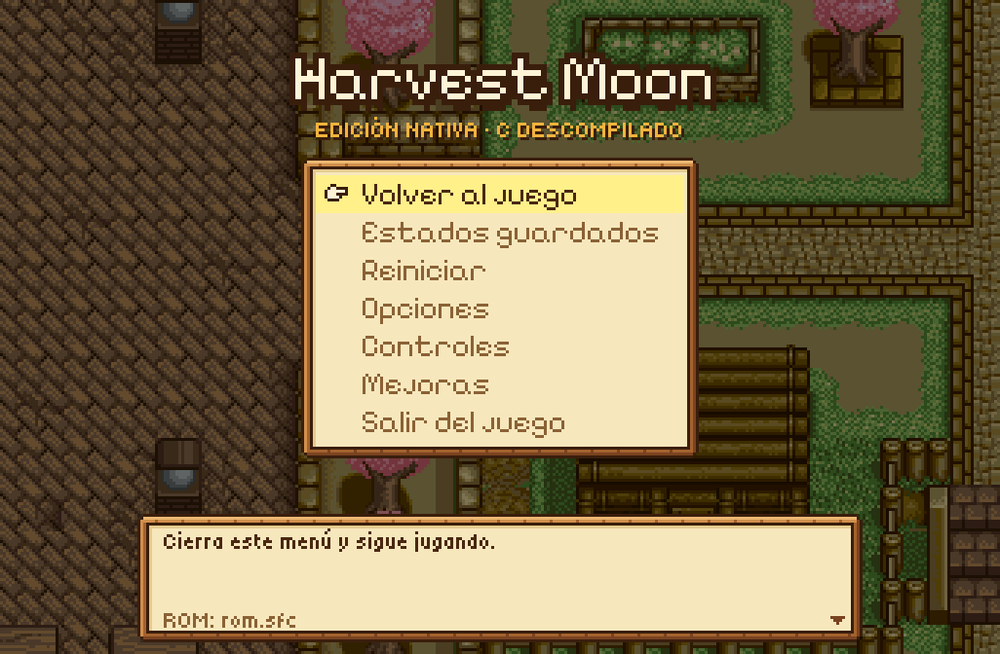 |

### Pantalla ancha 16:9 *(activada por defecto)*

Muestra más mapa a los lados en lugar de barras negras, con personajes y
animales también en los márgenes. Al borde de un mapa, en cuartos pequeños
y en el título vuelve al 4:3 original, porque ahí el juego no tiene nada que
dibujar. Se apaga en Opciones o en Mejoras.

| Original (4:3) | Pantalla ancha (16:9) |
|---|---|
| 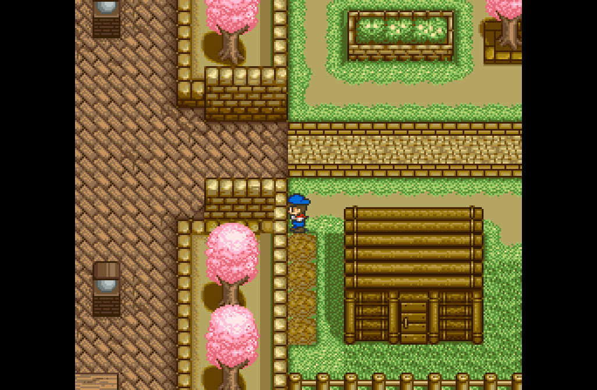 | 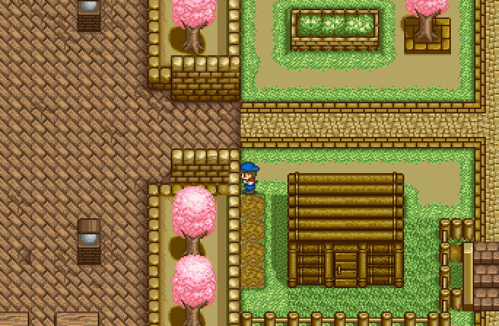 |

### Menú de pausa estilo Harvest Moon 64 *(M o R3)*

Fecha y reloj, dinero y energía; **Herramientas** (mano, mochila y la
bodega: equipar, cambiar y guardar con las reglas del propio juego);
**Corazones** (la cara de cada chica, su propio sprite leído de tu ROM,
con diez corazones); **Granja** (envíos, madera, forraje, vacas, felicidad,
el clima de mañana). La música sigue sonando.

| Herramientas | Corazones | Granja |
|---|---|---|
| 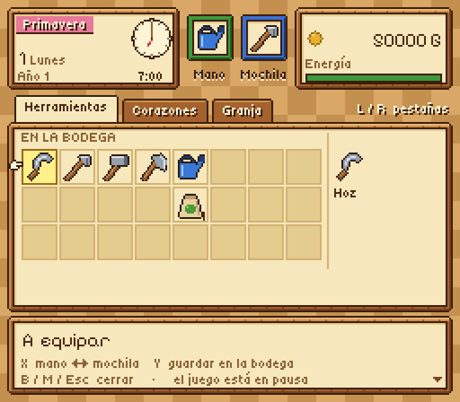 | 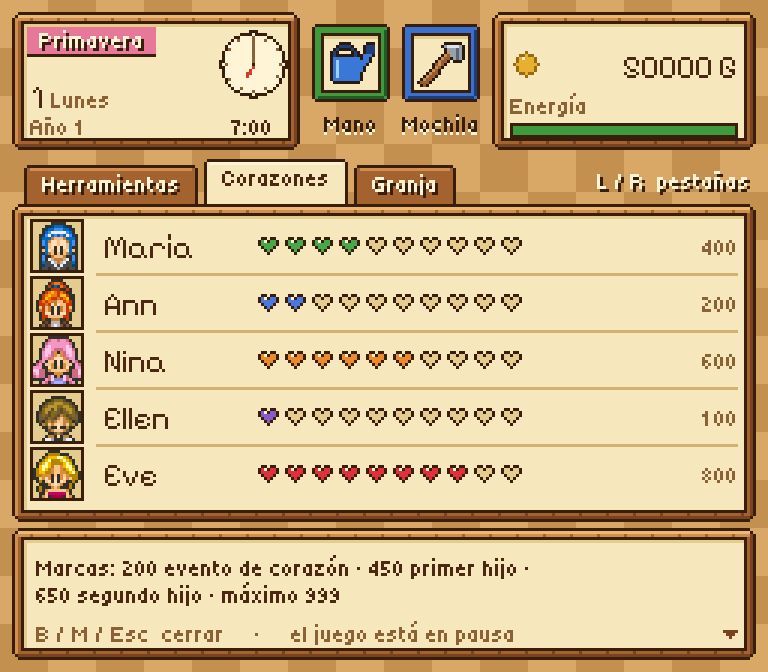 | 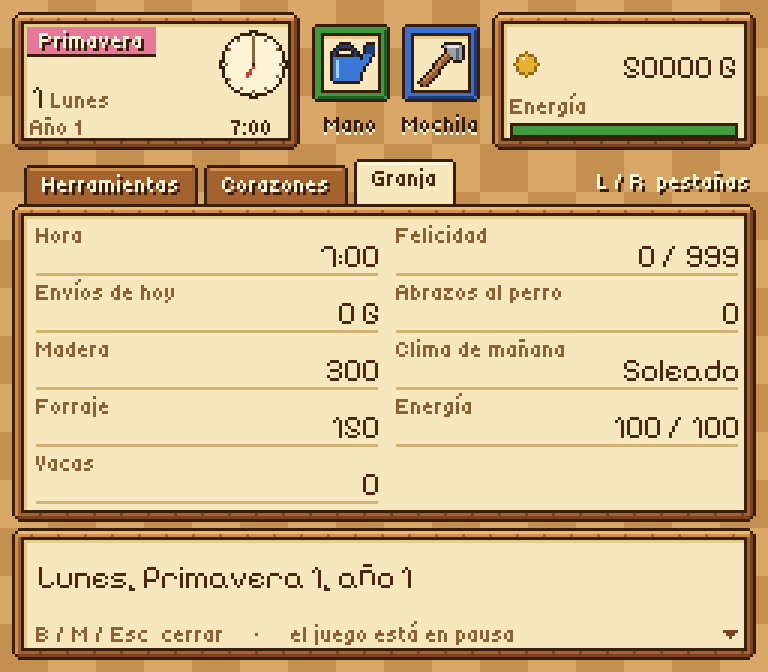 |

### Las demás mejoras (las de la recompilación)

- **Juego sin fin** *(activado por defecto)* — ves el final del año 3
  completo y luego sigues con tu granja: otoño, año 4, 5 y más; el diario
  dice "4th", "5th"…
- **OPTIONS en la pantalla de título** — una cuarta opción debajo de HOW TO
  PLAY que abre el launcher.
- **Texto rápido** (4×) y **días más largos** (1.5× a 4×).
- **Trucos** *(apagados por defecto)* — dinero infinito, energía infinita,
  detener el reloj, madera y forraje infinitos, semillas y alimento
  infinitos, controlar el clima. Solo ponen valores que el juego puede
  tener, así que tus partidas siguen válidas si los apagas.
- **Avance rápido** — mantén Tab (o el gatillo derecho): el juego va ×2 a
  ×6 y la música se acelera con él.

| OPTIONS en el título | Mejoras | Trucos |
|---|---|---|
| 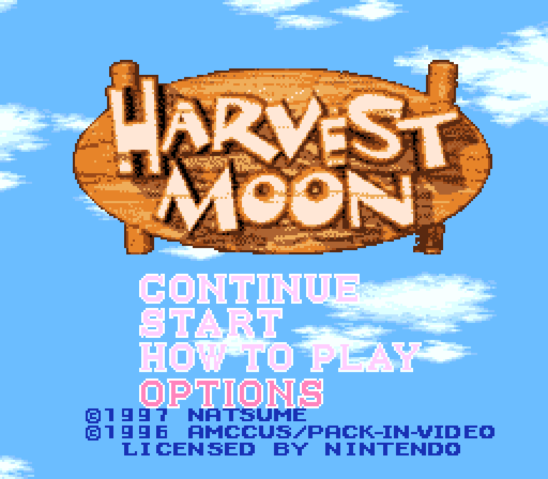 | 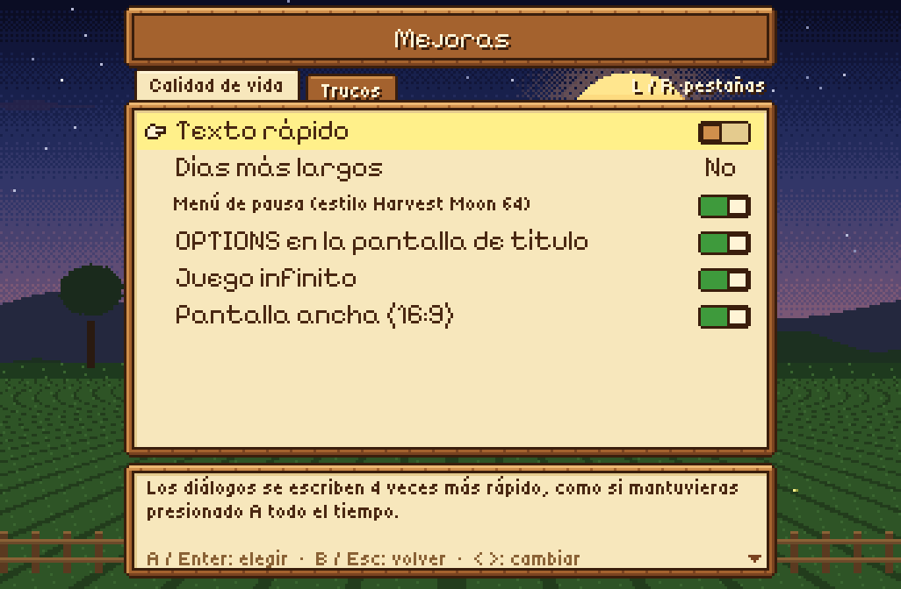 | 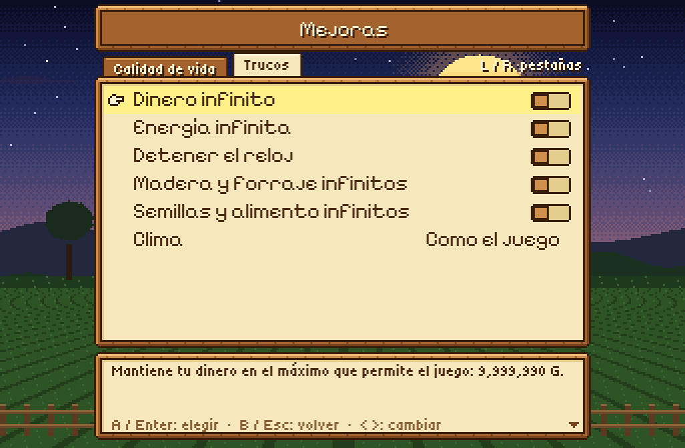 |

Con todas las mejoras apagadas, el juego es exactamente el de la consola.

### Controles

| Tecla | SNES / acción |
|---|---|
| Flechas | Cruceta |
| X / Z / S / A | A / B / X / Y |
| C / V | L / R |
| Enter / Shift derecho | Start / Select |
| Esc (mando: L3 o Guía) | Launcher (el juego en pausa) |
| M (mando: R3) | Menú de pausa |
| Tab (mando: gatillo derecho), mantener | Avance rápido |
| F1…F10 / Shift+F1…F10 | Cargar / guardar estado |
| F11 o Alt+Enter | Pantalla completa |

Todo se cambia en Controles.

### Por qué existe

Harvest Moon es de mis juegos favoritos. Después de la recompilación quise
ir más lejos: entender el juego rutina por rutina y que se pudiera jugar
solo con ese código.

**Este proyecto se hizo con ayuda de IA.** Yo lo dirigí y estuve
supervisando cada paso: qué hacer, cómo debía comportarse, probarlo en mi
propia PC y decidir qué se queda. Si no te gusta que se haya hecho con
ayuda de IA, está perfecto: simplemente no lo uses.

## Aviso legal

Este repositorio **no contiene la ROM ni nada generado a partir de ella**
(ni código generado, ni ejecutables). Para compilar necesitas tu propia
copia legal de *Harvest Moon (USA)*:
SHA-256 `73a3aa87ddd5ce5df5ba51292316f42b6e128280179b0a1b11b4dcddc17d4163`.

## Qué está descompilado

| Sistema | Rutinas | Archivo |
|---|---|---|
| Números aleatorios | GetRNG, RNGReturn0toA ("dado de n caras") | `src/rng.c` |
| Aritmética | DivisionUnsigned | `src/math.c` |
| Clima | SetWeatherFlags, WeatherTomorrow, SUB_8281C0 (el pronóstico de la tele) | `src/weather.c` |
| Granja | GetTileIndex, LoadsDamageProbabilities, ClimateFarmDamageCheck, ClimateFarmDamagePrep, NightlyFarmTilesCheck, MonthlyFarmTilesCheck, CalculateFarmDevelopment, Sub_82A9A0 (pastar) | `src/farm.c` |
| Existencias y dinero | AddWood, AddGrass, AddPlayerHappiness, AddMoney | `src/stock.c` |
| Jugador | ChangeStamina, HaveLunch | `src/stamina.c` |
| Personas | FindMostLovedName, WifePregnanacyandChilds | `src/people.c` |
| Calendario | LoadsDateNames | `src/calendar.c` |
| Animales | GetsCowPointer, GetChickenPointer, AddCowHappiness, CowFeedingandStatus (la noche de los animales), AddNewCow, AddNewChicken, PlaceAnimalsOnMap (CODE_83C296: gallinas, vacas, perro y caballo en el mapa al que entras) | `src/animals.c` |
| Final | RanchMasteryCalculator (el puntaje final del rancho) | `src/ending.c` |
| Comandos de los guiones de evento | 57 de los 90: cada cuadro de la vaca, la gallina y el perro (Event_UNKCowRelated, Event_UNKChickenRelated, Event_UNKDogRelated), saltos y pruebas (JumptoInstruction, JumpifFlagSet / Equals / Between, JumpIfEqualsRNG, GetRNG), reloj (TimeRunning / Stopped, SetHour), jugador (SetPlayerPosition / Direction, SetTransitionDest, UNKSetAnimation), slots (NewCCStructure, UNKDisableCCstruct, UNKSetsCC10, UNKCCchanges2) y banderas | `src/eventcmds.c` |
| Eventos | SetCCPoiner, ResetsCurrentCCStructureLong / Short, SUB_8480F8, UNK_LoadCCDataLong / Short (arrancar un guion de evento) | `src/events.c` |
| Edición del mapa | EditTileonMap / EditTileonMapandsets0181, ChangeMapTile (CODE_81A688), QueueTileGraphicsDMA (CODE_81A6C1), SUB_81A801, SUB_81A83A, SUB_82B060, StartMapAnimation (CODE_81A5E1) | `src/mapedit.c` |
| DMA de video | AddProgrammedDMA (encolar una copia a VRAM / CGRAM para el próximo NMI), RemoveProgrammedDMA, UNK_SetDMA2 (un bloque de 2x2 casillas de BG3), UNK_SetDMA1 (una letra) | `src/dma.c` |
| Menús | SaveSlotMenuInputs, LoadSlotMenuInputs, StartMenuInputs, TitleMenuInputs, ListInputs (los botones de cada menú), ImmobileInputs (con un cuadro de texto abierto: acelerar, seguir, cerrar, elegir) | `src/menus.c` |
| Partidas guardadas | SaveGameSlot (todo el formato de la partida), LoadGameSlotResume, CheckSRAMIntegrity (el comprobador también compara la RAM con batería) | `src/save.c` |
| Sonido | UNK_Audio17 / 7 (esperar "listo"), UNK_Audio8, UNK_Audio15 / 19 (efectos de sonido), UNK_Audio16, UNK_Audio2 (órdenes al chip de sonido, comprobadas grabando sus respuestas) | `src/audio.c` |
| Cuadro de texto | PrintTextFrame (ADDDDFFFF: la impresora, código por código), StartTextBox, CloseTextBox (CODE_8393F9), SUB_83932D (borrar el cuadro), BlinkTextBoxArrow / TextBoxArrow / DrawTextBoxArrow (la flecha de "hay más texto"), FindLetterGraphics / DrawLetter / AdvanceLetterCursor / BlinkTextCursor (letras), PrintDigit (números) | `src/text.c` |
| Objetos | SpawnMapObject (CODE_81A500), CreateGameObject (CODE_858000), LoadGameObjectComponents, LoadSpriteComponent (sprites y los objetos que dejan las herramientas en el mapa) | `src/objects.c` |
| Herramientas | GetTileContent, UNK_CheckTileProperty, CheckToolSuccess, CalculateTileinFront, TileAtOffsetFromPlayer, PreCheckToolSuccess / Line / Square, SUB_82927D | `src/tools.c` |
| Usar las herramientas | Las 28 rutinas ToolUsed*: hoz, azada, martillo, hacha, sus versiones de oro, las cinco semillas, pintura, comida, medicina, poción, campana, ordeñadora, cepillo, habichuelas, semilla de gema, pluma azul, regadera, aspersor; SUB_829260 (usa el objeto en la mano: una rutina por objeto, por Tool_Used_Table) | `src/toolused.c` |

Algunas cosas que se descubrieron por el camino (detalles en los
comentarios de cada archivo):

- "1 de cada n" en el juego no es exactamente 1/n: RNGReturn0toA favorece
  un poco el 0.
- Lluvia 1/6 en primavera y 1/10 en verano y otoño; nieve 1/3 en invierno;
  huracán 1/30 en verano (1/60 con el caparazón de tortuga).
- El primer año trae dos tormentas fijas: invierno día 8 y verano día 30.
- De noche, la lluvia rompe cercas (1/96), el huracán además arranca pasto
  (1/16) y cultivos (1/4), y el año nuevo borra pasto (1/64) y cultivos
  (1/32).
- Un cultivo crece una etapa por noche solo si estaba regado; la lluvia
  riega todo. En otoño los cultivos regados solo se secan, y el primer día
  de invierno todos mueren y vuelven a tierra arada.
- El "desarrollo del rancho" de la evaluación final es simplemente cuántas
  casillas de la granja tienen cercas, cultivos o pasto.
- Una vaca con hambre puede enfermarse (1/4); si sigue enferma hasta el
  final, muere, salvo que mañana sea festival. El embarazo cuenta con un
  contador global, y la felicidad inicial de la cría (20 / 50 / 100) depende
  de la de la madre.
- Hijos: el primero pide 450 corazones de la esposa; el segundo, 650 y que
  el primero tenga 90 días; los dos, la casa en nivel 2. Un hijo nace 60
  días después de concebido.
- Si una herramienta funciona lo dice un bit de la tabla de propiedades de
  la casilla (hoz 01, azada 02, martillo 04, hacha 08, agua 10, semillas
  20), y solo desde los lados y en las estaciones que la casilla permite.
  Cualquier objeto que no esté en esa lista "funciona".
- El sufijo del día es "st/nd/rd" solo para los días 1-3, así que el juego
  escribe "21th", "22th" y "23th".
- **Un bug del juego original:** en CowFeedingandStatus, después de tirar el
  dado de 1/16 para una vaca que quedó afuera, el registro X se queda en 8
  bits; si además está la bandera de cerca rota ($0196 bit $0400),
  `LDY.W #$0002` en $83:BDE1 se lee como instrucción de 2 bytes y el `00`
  sobrante se ejecuta como `BRK`.
- Hallazgos con las herramientas: con la azada, una vez al día, 1 de 16
  una moneda (10 G) o si no 1 de 16 una bolsa de dinero (50 G); en
  primavera y verano 1 de 32 un topo; 1 de 64 una baya de poder, solo dos
  veces en todo el juego. La hoz encuentra una rana en verano (1 de 16,
  +2 de felicidad). Una baya más en la roca del manantial (martillo, 1 de
  4) y otra en un tocón fuera de la granja (hacha, 1 de 16).
- Las piedras grandes y los tocones se rompen al 6.º golpe (un mismo
  contador, $096D); el martillo y el hacha de oro, de un golpe. La azada
  de oro ara hasta 6 casillas en línea y para en la primera que no puede;
  la hoz de oro corta las 9 de alrededor. El hacha de oro se salta la
  revisión de "hoy no hay hallazgos".
- Las semillas solo prenden en su estación (maíz y tomate en verano, papa
  y nabo en primavera, pasto en primavera y verano); fuera de estación la
  casilla queda como un brote muerto.
- Pintar la casa: cuatro partes de la pared, +10 de felicidad cada una.
- El puntaje del rancho del final (0-999) suma dinero (máximo 78),
  animales (3 cada uno), energía máxima, corazones de las chicas,
  cultivos enviados, felicidad, la casa, los hijos, el reloj, el
  caparazón de tortuga, el desarrollo de la granja y la felicidad de cada
  vaca. **Errores:** corazones y envíos se recortan con `AND #$1FF` en vez
  de tener un tope (enviar 512 nabos cuenta 0), y del dinero solo cuentan
  los 16 bits bajos (655.360 G cuentan 0).
- El ánimo del perro cambia cada 2 segundos entre cinco estados y una
  tirada al azar decide qué hace; cada abrazo se cuenta ($7F1F52). Una
  gallina que no se levanta arranca otro guion cada $200 cuadros.
- Hay como mucho 10 "objetos del mapa" (los efectos que dejan las
  herramientas, como la hierba cortada). Si los 10 están en uso cuando hace
  falta un 11.º, el juego se congela: `BRA` a sí mismo en $81:A528.

## Carpetas

- `src/` — las rutinas reescritas y el comprobador (`hm_decomp.c/.h`).
- `native/` — la versión nativa: el juego corriendo solo sobre las rutinas
  reescritas (`main.c`: la ventana, los controles, el sonido; `hw.c`: los
  chips de la consola alrededor del C).
- `data/decomp_names.tsv` — nombres de 499 rutinas (de HM-Decomp).
- `tools/build.sh` — genera, renombra y compila el ejecutable de prueba.
- `tools/check.sh` — corre las pruebas (al azar, partida nueva y noches).
- `tools/progress.py` — calcula el porcentaje de arriba.
- `tools/import_decomp_names.py`, `tools/decomp_overrides.py` — herramientas.
- `scripts/` — recorridos automáticos usados por las pruebas.
- `GUIA.md` — **una guía de cómo funciona el juego por dentro**, para
  quien no sabe nada de esto, con todo lo descubierto hasta ahora (en
  inglés: `GUIDE.md`).
- `DECOMPILACION.md` — el método explicado. `ESTADO.md` — estado y notas.

## Uso

Con los tres proyectos uno al lado del otro:

```
HarvestMoonSNESRecomp/   (git clone + bash tools/apply_patches.sh)
HarvestMoonSnesDecomp/
HM-Decomp/
```

```
cd HarvestMoonSnesDecomp
tools/build.sh --rom /ruta/a/tu/rom.sfc            # HM_RECOMP=... si la recompilación está en otro lado
HM_ROM=/ruta/a/tu/rom.sfc tools/check.sh 2000 10   # 10 semillas x 2000 llamadas al azar + partidas
python3 tools/progress.py --decomp ../HM-Decomp --update-readme
```

La descompilación **no modifica** el proyecto de recompilación: genera su
propia copia del código a partir de tu ROM, le pone los nombres y los
comprobadores, y compila un ejecutable de prueba en `build/`. Sin
`HM_DECOMP_CHECK` / `HM_DECOMP_FUZZ`, ese ejecutable juega exactamente igual
que el juego normal.

## Cómo funciona la versión nativa

`native/` compila `src/*.c` (menos el comprobador) con los chips de imagen y
de sonido del runner de snesrecomp, sin modificarlos (`native/chips/`, con
sus licencias: PolyForm Noncommercial y las MIT / ISC de donde vienen). Cada espera del
cuadro siguiente pasa por `hm_nmi`, que dibuja el cuadro, lee los controles
y deja correr el chip de sonido; las rutinas que nunca vuelven (RESET, el
título, las demos, GameLoop…) dejan en `g_hm_next` a dónde saltan y `main`
llama a la siguiente. Los detalles están en la sección 5.34 de la
[guía](GUIA.md).

```
cmake -S native -B build/native
cmake --build build/native
build/native/HarvestMoonNative /ruta/a/tu/rom.sfc
```

Para Windows desde Linux: añadir `-DCMAKE_TOOLCHAIN_FILE=native/mingw-w64.cmake`
(MinGW-w64). SDL3 se compila desde el código si no hay uno instalado.
`--headless --script archivo --dump-dir carpeta` juega un guion (los mismos
comandos que el `--script` de la recompilación) sin ventana y guarda la
imagen y la WRAM; ahí las mejoras están apagadas salvo con `--mods`.

| Archivo | Qué hace |
|---|---|
| `native/main.c` | la ventana, el sonido, los controles, el ritmo, los estados guardados |
| `native/hw.c` | los chips de la consola alrededor del C (mapa de memoria, registros) |
| `native/launcher.c`, `native/ui.c` | el launcher y su dibujo |
| `native/mods.c`, `native/pause.c` | las mejoras de la recompilación y el menú de pausa |
| `native/config.c`, `native/i18n.c` | `config.ini` / `keybinds.ini` y los textos en tres idiomas |

El C descompilado solo tiene tres ganchos para las mejoras, con los valores
de la ROM por defecto, así que el comprobador no ve diferencia:
`g_hm_oam_right/left` (pantalla ancha), `g_hm_no_ending` (juego sin fin) y
`g_hm_year_suffix` ("4th", "5th"…).

Las letras del launcher y del menú de pausa son Pixelify Sans y Tiny5
(SIL Open Font License, `native/fonts/`); los iconos y la granja de noche
están dibujados para este proyecto, sin gráficos del juego.

## Licencia

[PolyForm Noncommercial 1.0.0](LICENSE), la misma que HarvestMoonSNESRecomp:
uso libre sin fines comerciales. Cubre solo el código de este repositorio,
no el juego ni sus datos.

## Créditos

- [HM-Decomp](https://github.com/ElisaS-Codes/HM-Decomp), de ElisaS-Codes y
  DasK: el desensamblado, los nombres y el mapa de RAM.
- [snesrecomp](https://github.com/RetroPortingToolKit/snesrecomp)
  (RetroPortingToolKit / Matthew Stanley): el recompilador estático sobre
  el que corre el comprobador, y los chips de imagen y de sonido de la
  versión nativa (`native/chips/`, con su licencia y sus créditos MIT / ISC).
- [HarvestMoonSNESRecomp](https://github.com/RodriLoy/HarvestMoonSNESRecomp):
  las mejoras, el menú de pausa, sus textos e iconos, y el mapa de RAM
  `hm_ram.h`, portados a la versión nativa.
- [SDL3](https://libsdl.org): ventana, sonido y mandos.
- [Pixelify Sans](https://github.com/eifetx/Pixelify-Sans) y
  [Tiny5](https://github.com/Gissio/font_tiny5) (SIL OFL): las letras de
  los menús.
- **Harvest Moon** © 1996 Pack-In-Video / AMCCUS, © 1997 Natsume. Todos
  los nombres, personajes y gráficos pertenecen a sus dueños; este es un
  proyecto de fan sin fines de lucro, no afiliado ni respaldado por ellos.
