# HarvestMoonSnesDecomp — Harvest Moon (SNES) reescrito en C

[English](README.md) · **Español**

<!-- progress -->


**100.00%** del código del juego reescrito en C y verificado: 45176 de 45176 instrucciones, 778 de 778 rutinas (100.0%).
Se calcula con `python3 tools/progress.py --decomp ../HM-Decomp` sobre el desensamblado de HM-Decomp.
<!-- /progress -->


Todo el juego reescrito, rutina por rutina, en C que una persona puede leer
y modificar, y **jugable solo sobre ese C**. Cada rutina se comprobó contra
la original byte por byte (toda la memoria, los registros del procesador y
los del DMA deben quedar idénticos). En sentido estricto es una
*reimplementación* en C: el juego se escribió en ensamblador 65816, así que
no había C original que recuperar. Parte del desensamblado de la comunidad
[HM-Decomp](https://github.com/ElisaS-Codes/HM-Decomp) (ElisaS-Codes y
DasK) y es proyecto hermano de
[HarvestMoonSNESRecomp](https://github.com/RodriLoy/HarvestMoonSNESRecomp).

## Jugarlo

> [!IMPORTANT]
> **Necesitas tu propia copia legal de Harvest Moon (USA).** No se incluye
> la ROM ni nada sacado de ella: la primera vez el programa te pide tu
> copia, la revisa y la recuerda. Por favor no pidas ROMs.

**[⬇ Descargar la última versión](https://github.com/RodoLy/HarvestMoonSnesDecomp/releases/latest)** · Novedades: [CHANGELOG.md](CHANGELOG.md)

| | Descarga | O compílalo tú |
|---|---|---|
| **Windows** 10/11 | `…-Windows.zip`: descomprime y abre `HarvestMoonNative.exe` | `build.bat` |
| **Mac** (macOS 11+) | `…-Mac.zip`: descomprime y doble clic en `Harvest Moon.command` | `build_mac.command` |
| **Android** 8+ | `…-Android.apk`: ábrelo en el equipo para instalarlo | `build_android.bat` (en Windows) |
| **Linux** (x86_64) | `…-Linux.tar.gz`: descomprime y ejecuta `./HarvestMoonNative` | [ver abajo](#compilar-y-comprobar) |

> [!NOTE]
> **La primera vez tu computadora o teléfono te va a advertir: es normal.**
> Los programas no están firmados con un certificado de pago y el APK no
> viene de la Play Store. Windows: **Más información → Ejecutar de todas
> formas**. Mac: clic derecho → **Abrir**. Android: permite instalar apps
> desde tu navegador o explorador. Las descargas las compila GitHub con
> este código público (pestaña **Actions**) y cada versión trae su SHA-256.

**En Android** los controles se dibujan en la pantalla con el aspecto de
los menús del juego (se ocultan cuando usas un mando o los botones del
equipo). En un equipo de dos pantallas como la **AYN Thor**, el menú de
pausa queda en vivo en la pantalla de abajo y se usa tocándolo (abre la
app en la pantalla de arriba).

| Controles táctiles | Las dos pantallas de la AYN Thor |
|---|---|
| 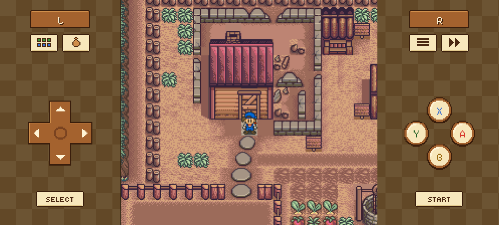 | 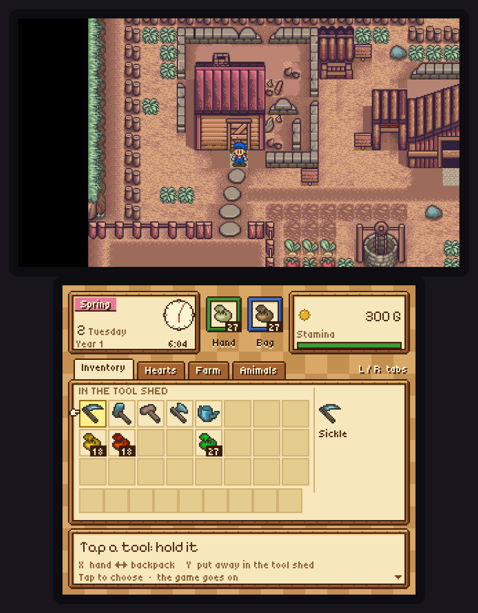 |

## Qué trae

**Todo viene apagado**, así que el juego es exactamente el de la consola:
activa lo que quieras en el launcher.

### Un launcher con el aspecto del juego

La primera pantalla del programa, dibujada a la resolución del SNES con los
marcos de madera del juego; en el juego se abre con **Esc** (o L3 / Guía) y
el juego queda en pausa. En inglés, español e italiano.

- **Opciones**: pantalla completa, tamaño de ventana, píxeles nítidos o
  exactos, vsync, pantalla ancha, sprites sin parpadeo, volumen, velocidad
  del avance rápido, idioma.
- **Controles**: **los mandos se configuran solos** (Xbox, PlayStation,
  Switch Pro, 8BitDo… por USB o Bluetooth): conectas uno y juegas. Igual
  puedes cambiar cada botón y cada tecla.
- **Estados guardados**: 10 espacios (F1–F10 cargar, Shift+F1–F10 guardar).

| Launcher | Opciones | Controles | Mando |
|---|---|---|---|
| 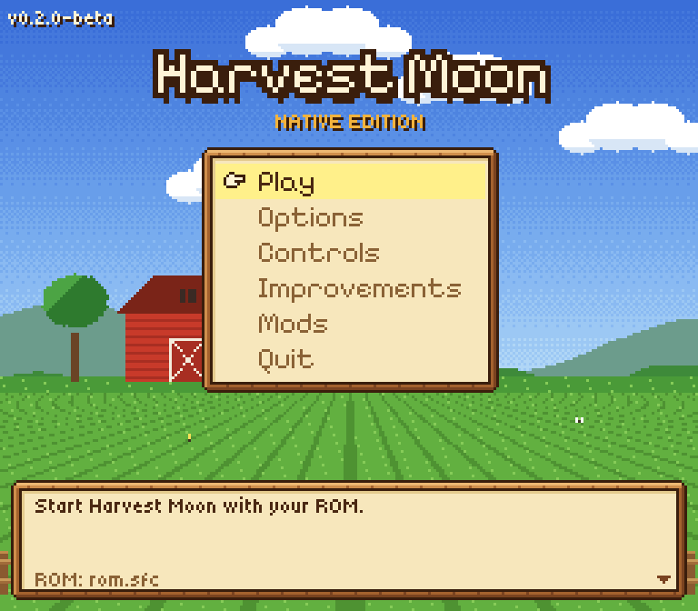 | 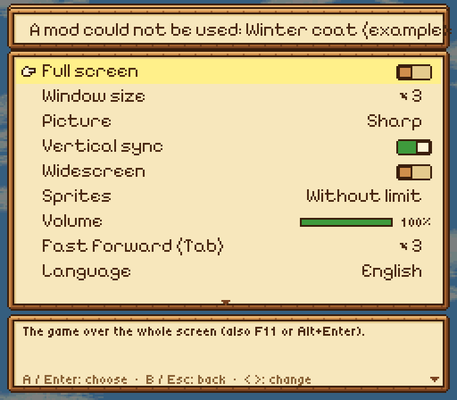 | 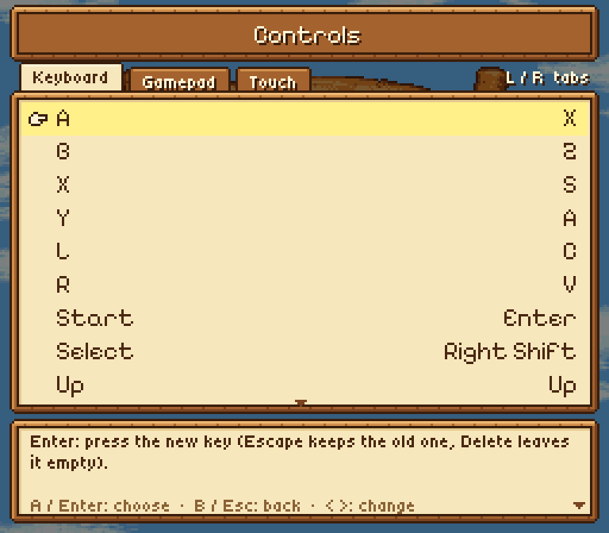 | 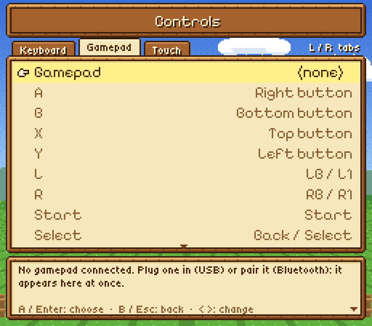 |

### Pantalla ancha

Más mapa a los lados en vez de franjas negras, tan ancho como tu pantalla
(16:9 o 16:10), también en las pantallas de inicio.

| Original (4:3) | Pantalla ancha |
|---|---|
| 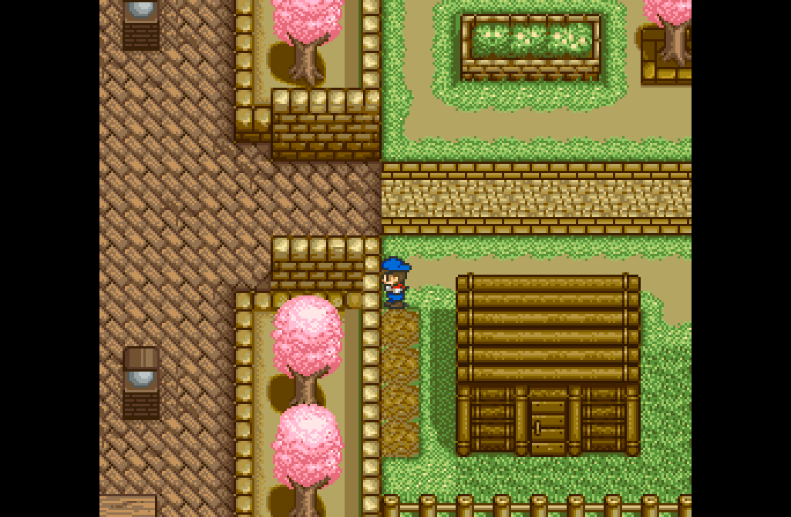 | 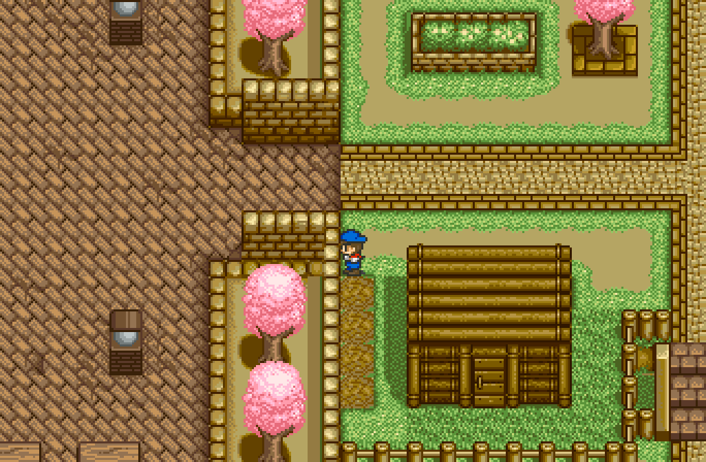 |

### Menú de pausa estilo Harvest Moon 64 *(M o R3)*

Fecha, dinero y energía; tus herramientas y la bodega; los corazones de
cada chica; el estado de la granja; y cada vaca y gallina con su propio
sprite, corazones y cuidados del día. Todas las imágenes son las del
juego, leídas de tu ROM.

| Inventario | Corazones | Granja | Animales |
|---|---|---|---|
| 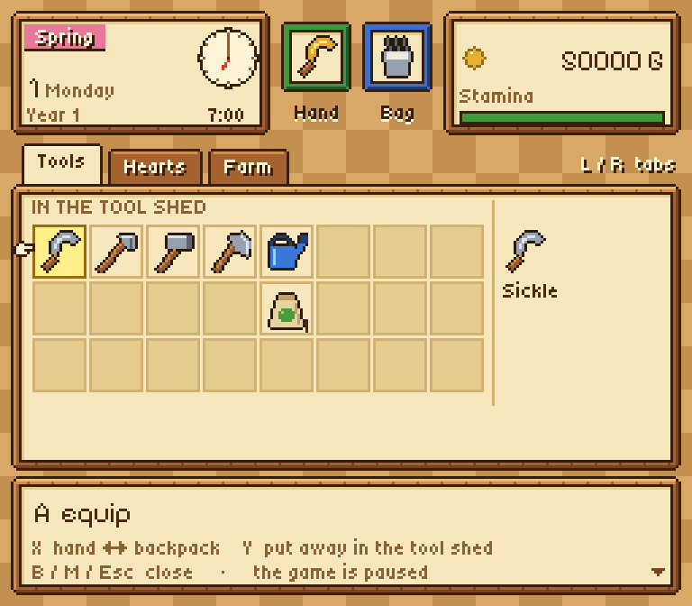 | 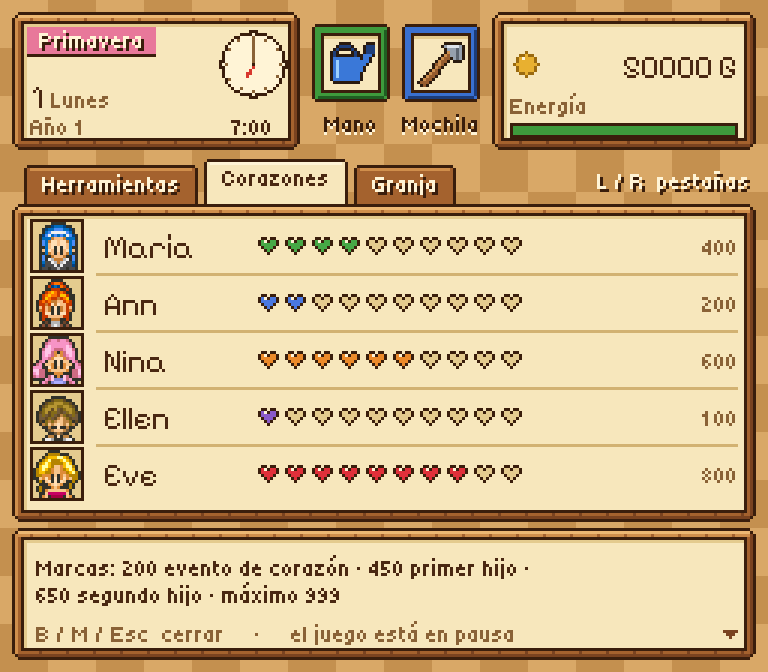 | 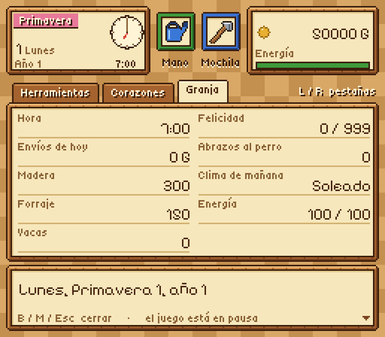 | 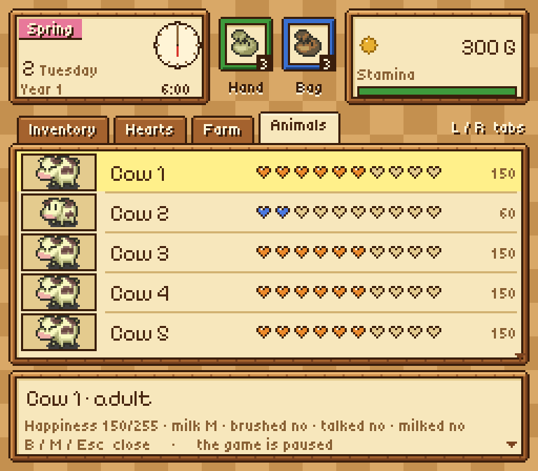 |

### Más mejoras

- **Mochila de cosechas** (con el menú de pausa): Q guarda lo que cargas,
  hasta 9; mantenida en la caja de envíos, los envía todos.
- **Tu esposa te ayuda**: casado y con sus diez corazones, te ofrece ayuda
  por un día, tres o una semana; en las mañanas alimenta a los animales y
  riega (la mitad del trabajo como máximo, cada planta lo mismo que tú).
- **Su ropa de soltera algunos días**: uno de cada dos días se viste con la
  ropa de antes de la boda.
- **Caminar entre cultivos** (se mecen al pasar) y **una semilla a la vez**.
- **Controles con ratón**: clic para usar una herramienta, caminar o hablar.
- **Juego sin fin**, **texto rápido**, **días más largos**, **OPTIONS en la
  pantalla de título**, **avance rápido** (Tab) y **trucos**.

| Mochila de cosechas | Tu esposa ofrece ayudarte | Su ropa de soltera |
|---|---|---|
| 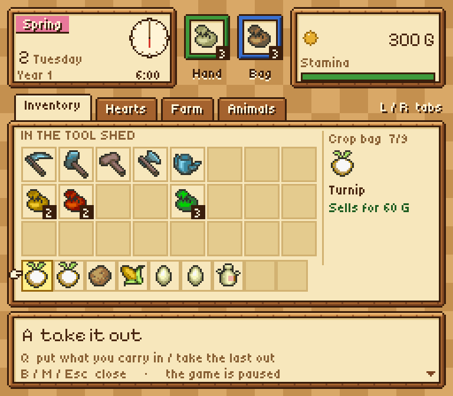 | 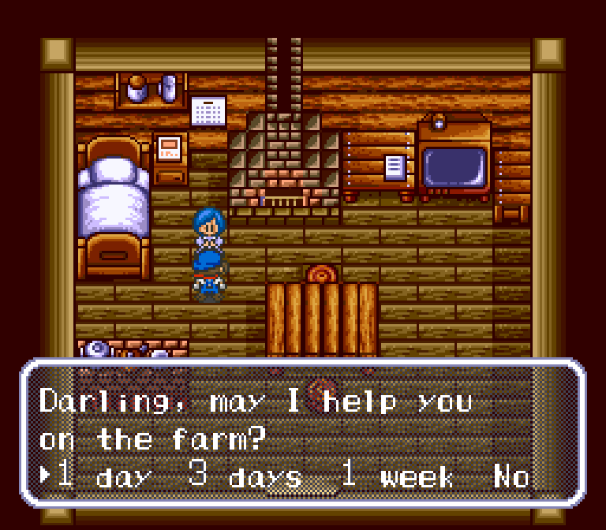 | 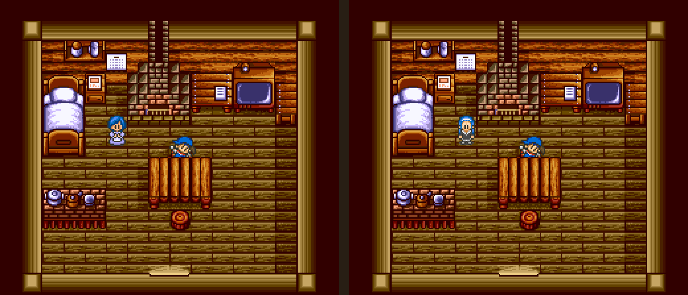 |

| Mejoras | Trucos | OPTIONS en el título |
|---|---|---|
| 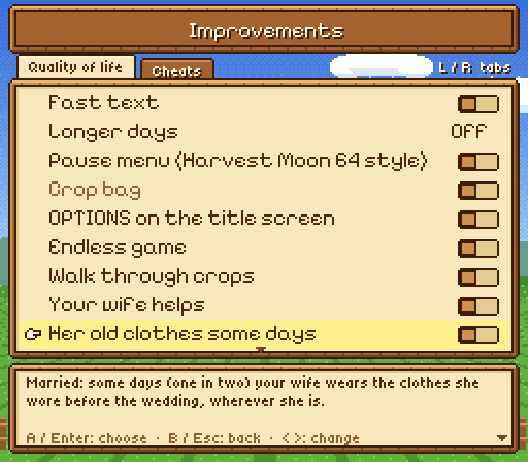 | 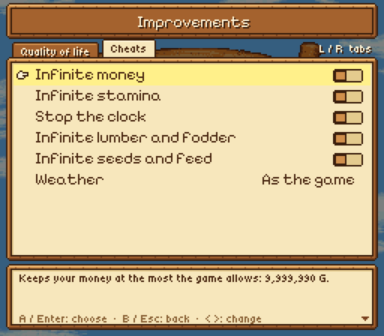 | 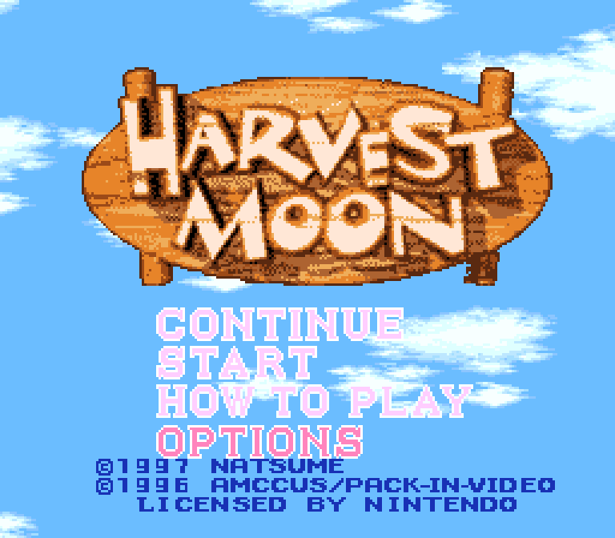 |

*(Las capturas muestran los menús en inglés; el idioma se cambia en Options → Language.)*

### Mods de la comunidad

Nuevas imágenes, textos, mapas o música como parches IPS / BPS, en una
carpeta dentro de `mods/`; la página **Mods** del launcher activa o apaga
cada uno. Tu ROM nunca se modifica. Cómo hacer uno:
[docs/MODS.es.md](docs/MODS.es.md).

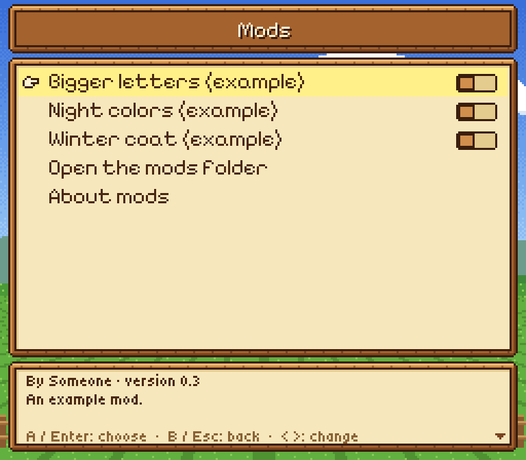

### Teclas

| Tecla | SNES / acción |
|---|---|
| Flechas · X Z S A · C V | Cruceta · A B X Y · L R |
| Enter · Shift derecho | Start · Select |
| Esc · M · Tab (mantenida) | Launcher · menú de pausa · avance rápido |
| F1…F10 · Shift+F1…F10 · F11 | Cargar · guardar un estado · pantalla completa |

## El código

Las 778 rutinas del juego están en `src/`, un archivo por sistema (el
clima, la granja, los animales, los eventos, los menús…), con nombres que
se leen: `src/hm_vars.h` nombra una sola vez cada variable que comparten
los archivos, con una nota de para qué sirve, y `src/hm_regs.h` los
registros de la consola. **[GUIDE.es.md](GUIDE.es.md)** explica cómo
funciona el juego por dentro, para quien no sabe nada de esto, con todo lo
descubierto en el camino (las probabilidades del clima, los errores del
juego original…). En inglés: [GUIDE.md](GUIDE.md).

- `src/` — las rutinas, y el comprobador que las compara con las
  originales (`hm_decomp.c`).
- `native/` — la versión jugable: la ventana, el sonido y los controles
  (`main.c`), el launcher, las mejoras, y los chips de imagen y sonido de
  la consola (`native/chips/`, de snesrecomp, sin cambios).
- `tools/`, `scripts/` — las pruebas y sus recorridos.
- `DECOMPILATION.md` (el método) y `STATUS.md` (notas).

### Compilar y comprobar

```
cmake -S native -B build/native && cmake --build build/native
build/native/HarvestMoonNative /ruta/a/tu/rom.sfc
```

Para Windows desde Linux agrega `-DCMAKE_TOOLCHAIN_FILE=native/mingw-w64.cmake`.
Para comparar las rutinas con las originales, con
[HarvestMoonSNESRecomp](https://github.com/RodriLoy/HarvestMoonSNESRecomp)
y HM-Decomp junto a esta carpeta:

```
tools/build.sh --rom /ruta/a/tu/rom.sfc
HM_ROM=/ruta/a/tu/rom.sfc tools/check.sh 2000 10
```

## Por qué existe

Harvest Moon es uno de mis juegos favoritos. Después de la recompilación
quise ir más lejos: entender el juego rutina por rutina y que se jugara
solo sobre ese código.

**Este proyecto se hizo con ayuda de IA.** Yo lo dirigí y supervisé cada
paso: qué hacer, cómo debía comportarse, probarlo en mi propia PC y decidir
qué se queda. Si no te gusta que se haya hecho con ayuda de IA, está bien:
simplemente no lo uses.

## Aviso legal

Este repositorio y sus versiones **no contienen la ROM ni nada generado a
partir de ella** (ni código, gráficos, textos o música del juego): los
programas leen tu copia al iniciar. Necesitas tu propia copia legal de
*Harvest Moon (USA)*: SHA-256
`73a3aa87ddd5ce5df5ba51292316f42b6e128280179b0a1b11b4dcddc17d4163`.

## Licencia

[PolyForm Noncommercial 1.0.0](LICENSE), la misma que HarvestMoonSNESRecomp:
libre para uso no comercial. Cubre solo el código de este repositorio, no
el juego ni sus datos.

## Créditos

- [HM-Decomp](https://github.com/ElisaS-Codes/HM-Decomp) de ElisaS-Codes y
  DasK: el desensamblado, los nombres y el mapa de la RAM.
- [snesrecomp](https://github.com/RetroPortingToolKit/snesrecomp)
  (RetroPortingToolKit / Matthew Stanley): el recompilador sobre el que
  corre el comprobador, y los chips de imagen y sonido (`native/chips/`,
  con sus licencias).
- [HarvestMoonSNESRecomp](https://github.com/RodriLoy/HarvestMoonSNESRecomp):
  las mejoras, el menú de pausa y el mapa de la RAM `hm_ram.h`.
- [SDL3](https://libsdl.org): ventana, sonido y mandos.
- [Pixelify Sans](https://github.com/eifetx/Pixelify-Sans) y
  [Tiny5](https://github.com/Gissio/font_tiny5) (SIL OFL): la letra de los
  menús. Los íconos y la granja del launcher se dibujaron para este proyecto.
- **Harvest Moon** © 1996 Pack-In-Video / AMCCUS, © 1997 Natsume. Todos los
  nombres, personajes y gráficos son de sus dueños; este es un proyecto de
  fans sin fines de lucro, sin relación ni aval de ellos.
