# HarvestMoonSnesDecomp — Harvest Moon (SNES) rewritten in C

**English** · [Español](README.es.md)

<!-- progress -->


**100.00%** of the game's code rewritten in C and verified: 45176 of 45176 instructions, 778 of 778 routines (100.0%).
Computed with `python3 tools/progress.py --decomp ../HM-Decomp` over the HM-Decomp disassembly.
<!-- /progress -->


The whole game rewritten, routine by routine, as C a person can read and
change, and **playable on that C alone**. Every routine was checked against
the original byte for byte (the whole memory, the CPU registers and the DMA
registers must come out identical). Strictly speaking it is a C
*reimplementation*: the game was written in 65816 assembly, so there was no
original C to recover. It builds on the community disassembly
[HM-Decomp](https://github.com/ElisaS-Codes/HM-Decomp) (ElisaS-Codes and
DasK) and is a sister project of
[HarvestMoonSNESRecomp](https://github.com/RodriLoy/HarvestMoonSNESRecomp).

## Play it

> [!IMPORTANT]
> **You need your own, legally obtained copy of Harvest Moon (USA).** No
> ROM and nothing taken from it is included: the first time, the program
> asks for your copy, checks it and remembers it. Please don't ask for ROMs.

**[⬇ Download v0.2.0-beta](https://github.com/RodoLy/HarvestMoonSnesDecomp/releases/tag/v0.2.0-beta)** (all versions: [Releases](https://github.com/RodoLy/HarvestMoonSnesDecomp/releases)) · What's new: [CHANGELOG.md](CHANGELOG.md)

| | Download | Or build it yourself |
|---|---|---|
| **Windows** 10/11 | [**HarvestMoon-0.2.0-beta-Windows.zip**](https://github.com/RodoLy/HarvestMoonSnesDecomp/releases/download/v0.2.0-beta/HarvestMoon-0.2.0-beta-Windows.zip): unzip, open `HarvestMoonNative.exe` | `build.bat` |
| **Mac** (macOS 11+) | [**HarvestMoon-0.2.0-beta-Mac.zip**](https://github.com/RodoLy/HarvestMoonSnesDecomp/releases/download/v0.2.0-beta/HarvestMoon-0.2.0-beta-Mac.zip): unzip, double-click `Harvest Moon.command` | `build_mac.command` |
| **Android** 8+ | [**HarvestMoon-0.2.0-beta-Android.apk**](https://github.com/RodoLy/HarvestMoonSnesDecomp/releases/download/v0.2.0-beta/HarvestMoon-0.2.0-beta-Android.apk): open it on the device to install it | `build_android.bat` (on Windows) |
| **Linux** (x86_64) | [**HarvestMoon-0.2.0-beta-Linux.tar.gz**](https://github.com/RodoLy/HarvestMoonSnesDecomp/releases/download/v0.2.0-beta/HarvestMoon-0.2.0-beta-Linux.tar.gz): unpack, run `./HarvestMoonNative` | [see below](#building-and-checking) |

> [!NOTE]
> **The first time, your computer or phone will warn you: that is
> expected.** The programs are not signed with a paid certificate and the
> APK is not from the Play Store. Windows: **More info → Run anyway**. Mac:
> right-click → **Open**. Android: allow installing apps from your browser
> or file manager. The downloads are built by GitHub from this public
> source (the **Actions** tab) and each release lists their SHA-256.

**On Android** the controls are drawn on the screen in the look of the
game's menus (they hide when you use a gamepad or the device's buttons).
On a two-screen device like the **AYN Thor**, the pause menu stays live on
the lower screen, used by touch (launch the app on the top screen).

| Touch controls | The AYN Thor's two screens |
|---|---|
| 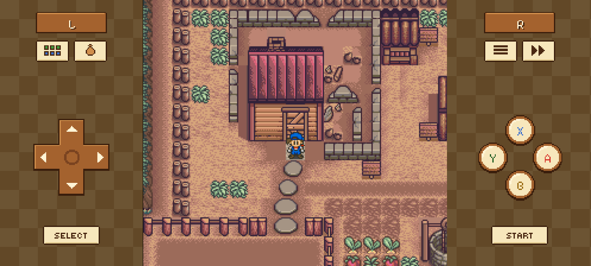 | 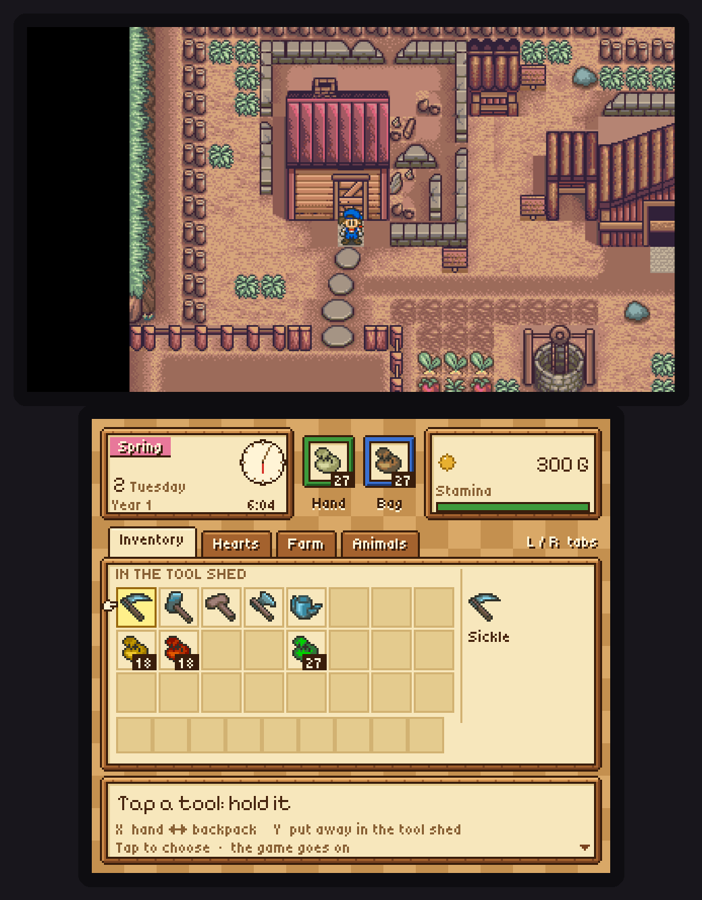 |

## What it brings

**Everything starts off**, so the game is exactly the console's: turn on
what you like in the launcher.

### A launcher in the look of the game

The program's first screen, drawn at the SNES's resolution with the game's
wooden frames; in the game it opens with **Esc** (or L3 / Guide), with the
game paused. In English, Spanish and Italian.

- **Options**: full screen, window size, sharp or exact pixels, vsync,
  widescreen, sprites without flicker, volume, fast-forward speed, language.
- **Controls**: **gamepads are mapped automatically** (Xbox, PlayStation,
  Switch Pro, 8BitDo… USB or Bluetooth): plug one in and play. Every
  button and key can still be changed.
- **Save states**: 10 slots (F1–F10 load, Shift+F1–F10 save).

| Launcher | Options | Controls | Gamepad |
|---|---|---|---|
| 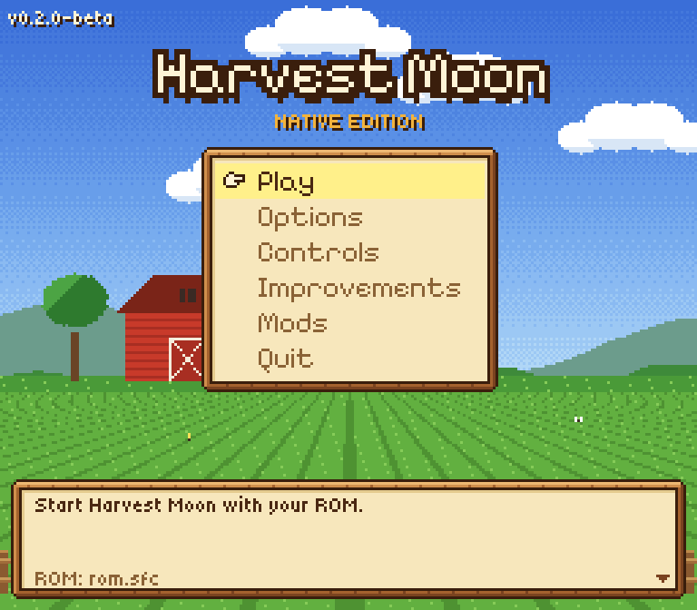 | 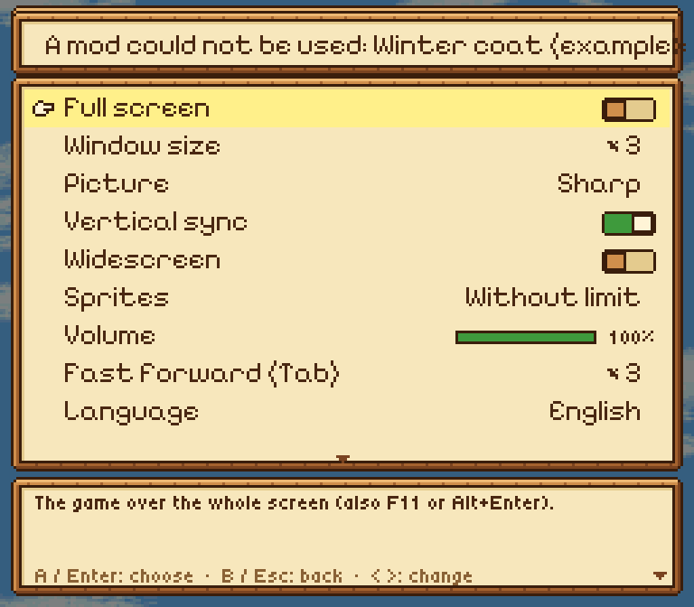 | 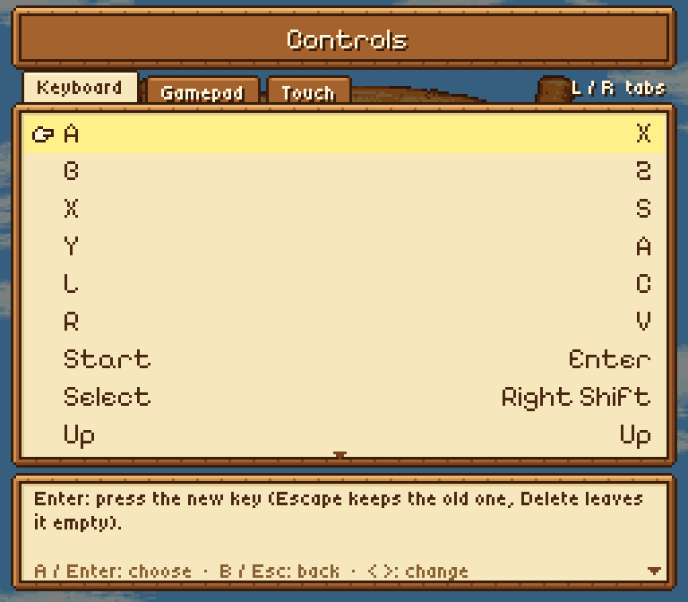 | 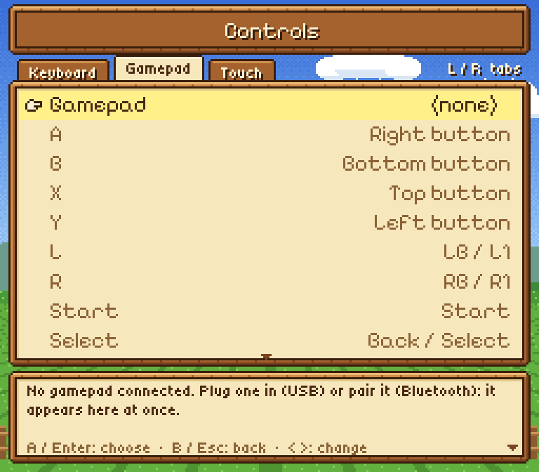 |

### Widescreen

More of the map at the sides instead of black bars, as wide as your screen
(16:9 or 16:10), the start screens included.

| Original (4:3) | Widescreen |
|---|---|
| 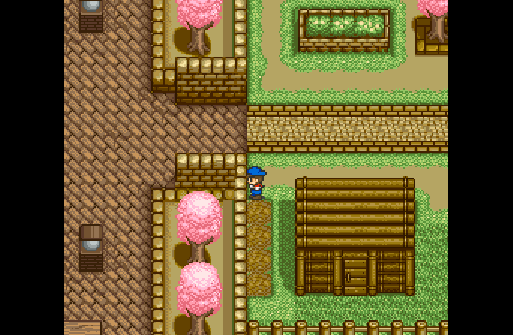 | 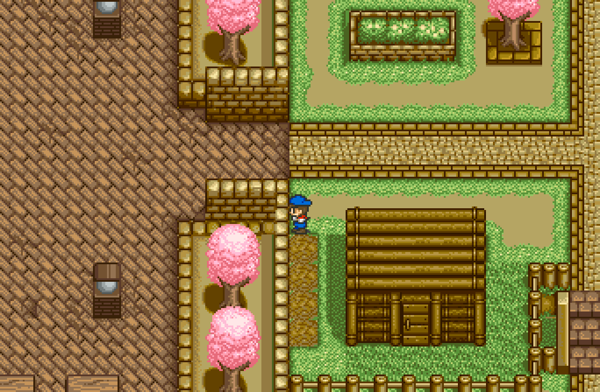 |

### Harvest Moon 64-style pause menu *(M or R3)*

Date, money and stamina; your tools and the tool shed; each girl's hearts;
the farm's status; and every cow and chicken with its own sprite, hearts
and today's care. All pictures are the game's own, read from your ROM.

| Inventory | Hearts | Farm | Animals |
|---|---|---|---|
| 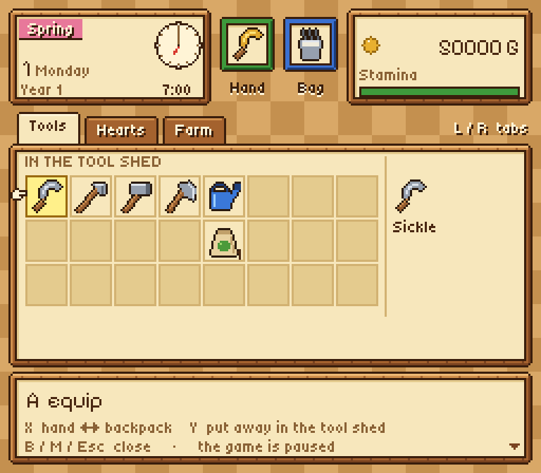 | 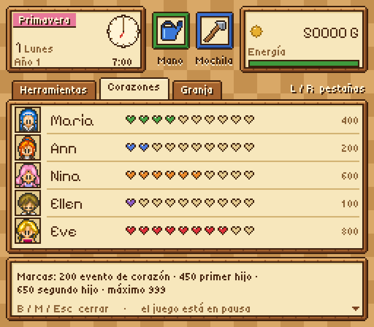 | 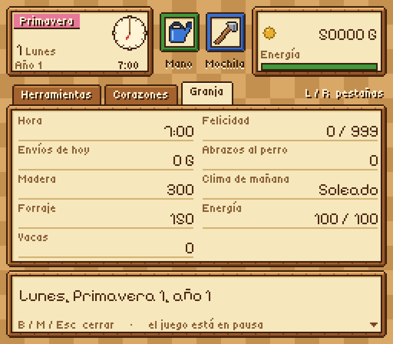 | 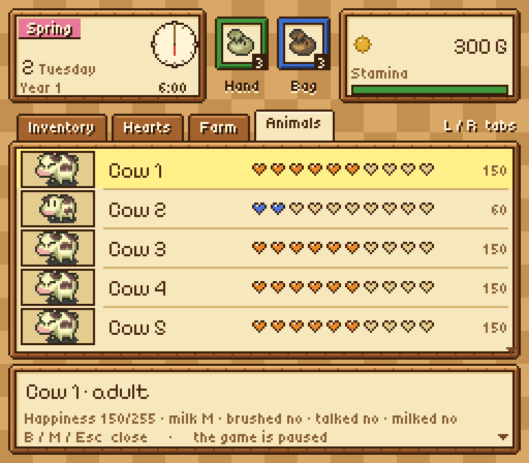 |

### More improvements

- **Crop bag** (with the pause menu): Q keeps what you carry, up to 9;
  held at the shipping box, it ships them all.
- **Your wife helps**: married, with her ten hearts, she offers to help
  for a day, three or a week; mornings she feeds the animals and waters
  (half of the work at most, each plant as long as you would).
- **Her old clothes some days**: one day in two she wears the clothes from
  before the wedding.
- **Walk through crops** (they sway as you pass) and **one seed at a time**.
- **Mouse controls**: click to use a tool, walk or talk.
- **Endless game**, **fast text**, **longer days**, **OPTIONS on the title
  screen**, **fast forward** (Tab) and **cheats**.

| Crop bag | Your wife offers to help | Her old clothes |
|---|---|---|
| 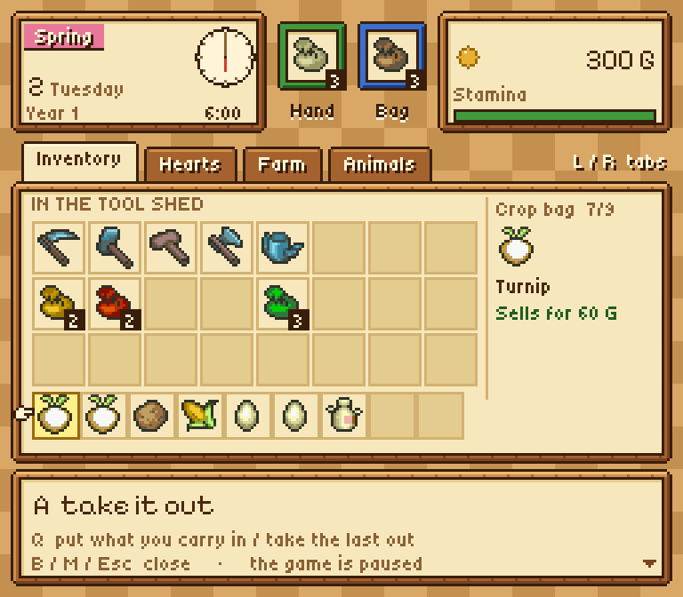 | 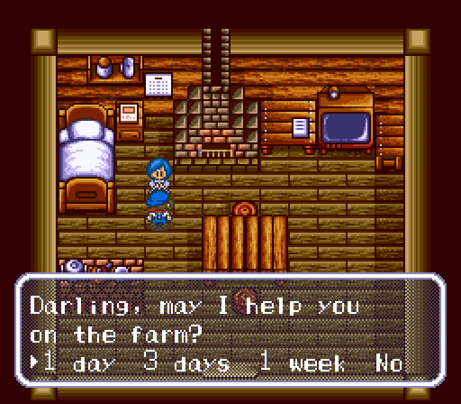 | 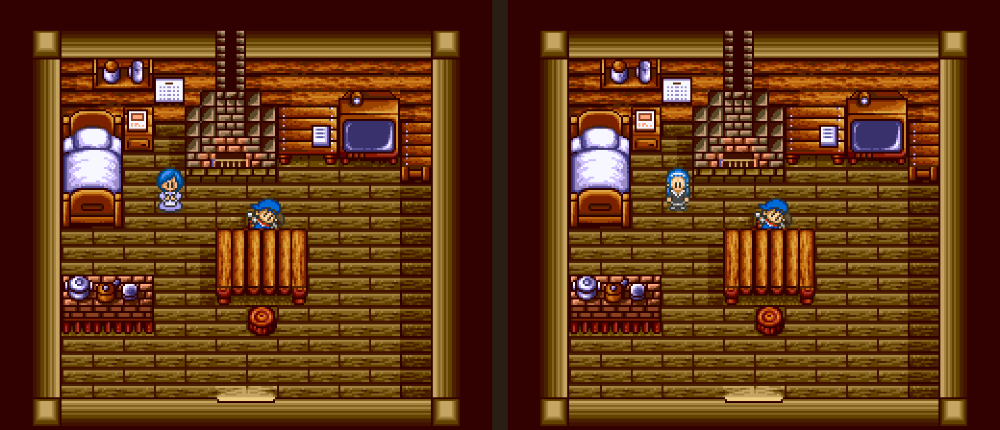 |

| Improvements | Cheats | OPTIONS on the title |
|---|---|---|
| 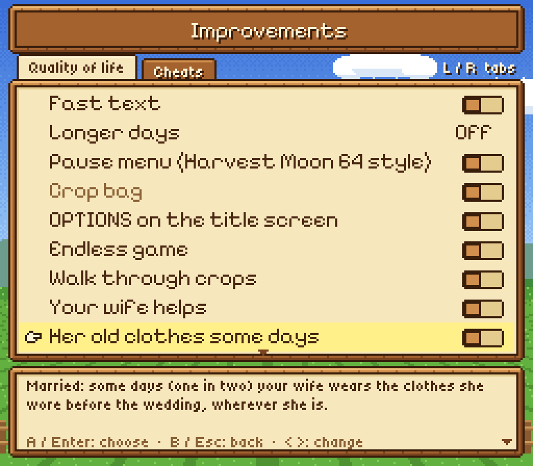 | 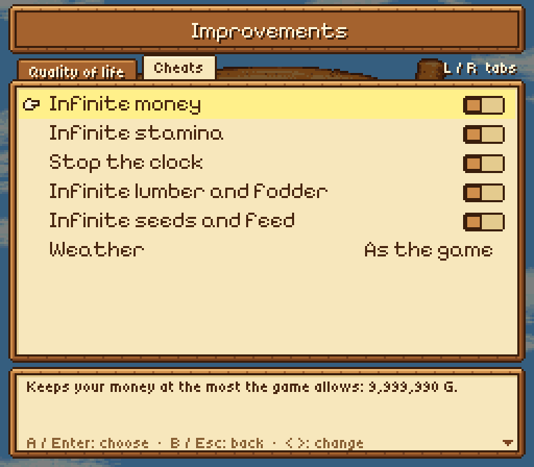 | 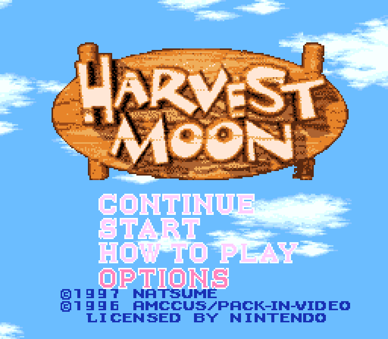 |

### Mods from the community

New pictures, text, maps or music as IPS / BPS patches, in a folder inside
`mods/`; the launcher's **Mods** page turns each one on or off. Your ROM
file is never changed. How to make one: [docs/MODS.md](docs/MODS.md).

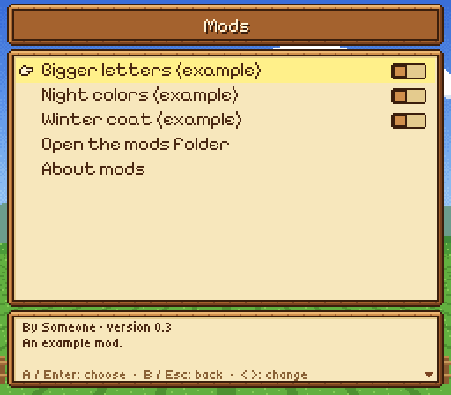

### Keys

| Key | SNES / action |
|---|---|
| Arrows · X Z S A · C V | D-pad · A B X Y · L R |
| Enter · Right Shift | Start · Select |
| Esc · M · Tab (held) | Launcher · pause menu · fast forward |
| F1…F10 · Shift+F1…F10 · F11 | Load · save a state · full screen |

## The code

All 778 routines of the game are in `src/`, one file per system (the
weather, the farm, the animals, the events, the menus…), with readable
names: `src/hm_vars.h` names once every variable the files share, with a
note on what it is for, and `src/hm_regs.h` the console's registers.
**[GUIDE.md](GUIDE.md)** explains how the game works inside, for someone
new to it, with everything found along the way (the weather's odds, the
original game's bugs…). Spanish: [GUIDE.es.md](GUIDE.es.md).

- `src/` — the routines, and the checker that compares them with the
  original (`hm_decomp.c`).
- `native/` — the playable build: the window, sound and pads (`main.c`),
  the launcher, the improvements, and the console's picture and sound chips
  (`native/chips/`, from snesrecomp, unmodified).
- `tools/`, `scripts/` — the checks and their playthroughs.
- `DECOMPILATION.md` (the method) and `STATUS.md` (notes), in Spanish.

### Building and checking

```
cmake -S native -B build/native && cmake --build build/native
build/native/HarvestMoonNative /path/to/your/rom.sfc
```

For Windows from Linux add `-DCMAKE_TOOLCHAIN_FILE=native/mingw-w64.cmake`.
To check the routines against the original, with
[HarvestMoonSNESRecomp](https://github.com/RodriLoy/HarvestMoonSNESRecomp)
and HM-Decomp next to this folder:

```
tools/build.sh --rom /path/to/your/rom.sfc
HM_ROM=/path/to/your/rom.sfc tools/check.sh 2000 10
```

## Why it exists

Harvest Moon is one of my favourite games. After the recompilation I
wanted to go further: understand the game routine by routine, and have it
play on that code alone.

**This project was made with the help of AI.** I directed it and
supervised every step: what to do, how it should behave, testing it on my
own PC and deciding what stays. If you don't like that it was made with
AI's help, that's fine: just don't use it.

## Legal notice

This repository and its releases **contain no ROM and nothing generated
from one** (no code, graphics, text or music of the game): the programs read
your copy when they start. You need your own legal copy of *Harvest Moon
(USA)*: SHA-256
`73a3aa87ddd5ce5df5ba51292316f42b6e128280179b0a1b11b4dcddc17d4163`.

## License

[PolyForm Noncommercial 1.0.0](LICENSE), the same as HarvestMoonSNESRecomp:
free for non-commercial use. It covers this repository's code only, not the
game or its data.

## Credits

- [HM-Decomp](https://github.com/ElisaS-Codes/HM-Decomp) by ElisaS-Codes and
  DasK: the disassembly, the names and the RAM map.
- [snesrecomp](https://github.com/RetroPortingToolKit/snesrecomp)
  (RetroPortingToolKit / Matthew Stanley): the recompiler the checker runs
  on, and the picture and sound chips (`native/chips/`, with their licenses).
- [HarvestMoonSNESRecomp](https://github.com/RodriLoy/HarvestMoonSNESRecomp):
  the improvements, the pause menu and the RAM map `hm_ram.h`.
- [SDL3](https://libsdl.org): window, sound and gamepads.
- [Pixelify Sans](https://github.com/eifetx/Pixelify-Sans) and
  [Tiny5](https://github.com/Gissio/font_tiny5) (SIL OFL): the menus' type.
  The icons and the launcher's farm are drawn for this project.
- **Harvest Moon** © 1996 Pack-In-Video / AMCCUS, © 1997 Natsume. All
  names, characters and graphics belong to their owners; this is a
  non-profit fan project, not affiliated with or endorsed by them.
